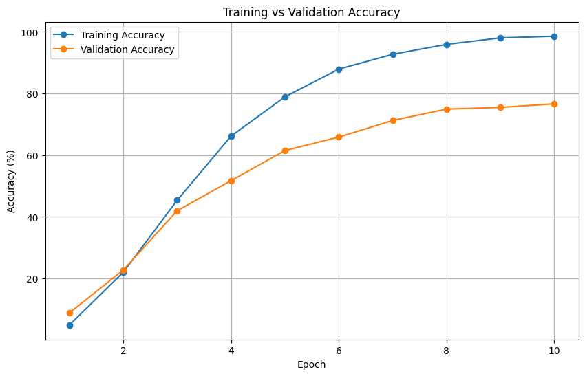
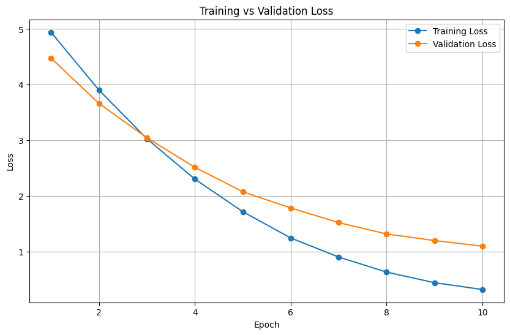
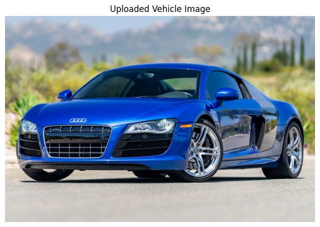
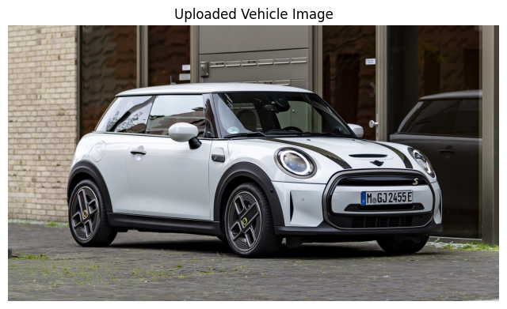

# Fine-Grained Vehicle Classification Using Vision Transformers (ViT-B/16)

[](https://www.python.org/)
[](https://pytorch.org/)
[](https://huggingface.co/)
[](https://huggingface.co/datasets/mteb/StanfordCars)
[](#student-and-academic-details)

---

## Student and Academic Details
In compliance with **Step 5** of the *Batch F – Capstone Project Guidelines & Submission Process*, the project metadata is documented below:

| Detail Field | Specification |
|---|---|
| **Student Name** | **Arnav Arya** |
| **Registration Number** | **2430010362** |
| **Academic Branch** | **B.Tech Computer Science Engineering** |
| **Academic Batch** | **Batch F** |
| **Project Title** | **Fine-Grained Vehicle Classification Using Vision Transformers (ViT-B/16)** |
| **GitHub Username** | **[arnavarya11](https://github.com/arnavarya11)** |
| **Personal Repository** | **[MUJ-DS-2430010362](https://github.com/arnavarya11/MUJ-DS-2430010362)** |
| **Training Program** | **Capstone Project Training Program – Batch F** |

---

## Project Overview
Fine-Grained Visual Categorization (FGVC) is a core challenge in computer vision where intra-class variance frequently surpasses inter-class variance. In automotive classification, distinct vehicle makes and models share similar aerodynamic bodies, while vehicles within the same class present drastically different appearances due to paint colors, viewing perspectives, lighting conditions, and background clutter.

This capstone project implements an end-to-end deep learning framework for classifying car images across **196 fine-grained categories** (spanning specific Make, Model, and Year) using the **Stanford Cars** dataset. We employ a transfer learning approach leveraging the **Vision Transformer (ViT-B/16)** architecture (`google/vit-base-patch16-224`) fine-tuned with the AdamW optimizer and on-the-fly spatial augmentations.

### Key Performance Milestones
- **Best Validation Accuracy:** **76.67%** (achieved at Epoch 10)
- **Test Top-1 Accuracy:** **77.02%**
- **Test Top-5 Accuracy:** **94.80%**
- **Weighted F1-Score:** **76.84%**
- **Macro F1-Score:** **76.78%**

---

## Results Summary

| Evaluation Metric | Score | Benchmark Insight |
|---|---|---|
| **Top-1 Accuracy** | **77.02%** | Correct exact Make, Model, and Year on unseen test data |
| **Top-5 Accuracy** | **94.80%** | True vehicle is present among top 5 candidates in ~95% of cases |
| **Weighted Precision** | **78.10%** | High positive predictive value across classes |
| **Weighted Recall** | **77.02%** | High sensitivity across classes |
| **Weighted F1-Score** | **76.84%** | Harmonic mean reflecting balanced precision and recall |
| **Macro Precision** | **78.02%** | Unweighted precision across all 196 classes |
| **Macro Recall** | **76.98%** | Unweighted recall across all 196 classes |
| **Macro F1-Score** | **76.78%** | Strong multi-class generalization across rare and frequent classes |

---

## Key Visualizations

### 1. Training Convergence & Loss/Accuracy Trajectories
The model was fine-tuned for 10 epochs. Cross-entropy loss steadily decreased from $4.9415 \rightarrow 0.3146$ (training) and $4.4773 \rightarrow 1.0938$ (validation), while validation accuracy ascended smoothly from $8.84\% \rightarrow 76.67\%$.

| Training & Validation Loss | Training & Validation Accuracy |
|:---:|:---:|
|  |  |

### 2. Confusion Matrix (196 Fine-Grained Classes)
A full-scale $196 \times 196$ confusion matrix computed over all 8,041 test images exhibits a dominant diagonal, proving robust discriminative capability across subtle model trims:

<p align="center">
  
</p>

### 3. Class-Level Performance Analysis (Best 10 vs. Worst 10 Classes)
Vehicles with distinct silhouettes (e.g. AM General Hummer SUV, Dodge Caravan, Fiat 500 Abarth) achieve near-perfect F1-scores ($\ge 0.98$). Performance dips occur predominantly between badge-engineered platform twins (e.g., Chevrolet Express Passenger vs. Cargo Van, Audi S4 Sedan vs. Audi S5 Coupe).

<p align="center">
  
</p>

### 4. Real-World Inference Demonstrations
The model was evaluated against arbitrary external real-world vehicle images:

| Audi R8 Coupe 2012 (69.81% Confidence) | Mini Cooper Roadster 2012 (31.76% Confidence) |
|:---:|:---:|
|  |  |

---

## Repository Structure
In strict compliance with **Step 4** and **Step 11** of the Capstone Guidelines, the repository is organized as follows:

```
MUJ-DS-2430010362/
├── README.md               # Step 5: Primary project documentation and results
├── INSTALLATION.md         # Step 11: Comprehensive setup and execution manual
├── requirements.txt        # Step 11: Python package dependencies
├── assignments/            # Step 4 & 6: Weekly milestone reports & activity logs
│   ├── weekly_progress_log.md
│   ├── assignment_1_eda_and_dataset_pipeline.md
│   ├── assignment_2_baseline_and_vit_architecture.md
│   ├── assignment_3_model_training_and_hyperparameters.md
│   └── assignment_4_evaluation_metrics_and_error_analysis.md
├── notebooks/              # Step 4: Full experimental notebook workflow
│   ├── 2430010362.ipynb    # Executed 62-cell Jupyter notebook
│   └── README.md           # Instructions for Colab and local execution
├── code/                   # Step 4 & 11: Modular source code package
│   ├── __init__.py         # Package initialization
│   ├── dataset.py          # Data ingestion, splitting, and augmentation
│   ├── model.py            # Vision Transformer architecture wrapper
│   ├── train.py            # CLI training pipeline with checkpointing
│   ├── evaluate.py         # CLI test set evaluation and metric generation
│   ├── predict.py          # Standalone CLI inference tool
│   └── utils.py            # Metrics, confusion matrix, and plotting helpers
├── resources/              # Step 4: Reference data, taxonomies & guides
│   ├── classes.json        # 196 Stanford Cars class labels
│   ├── classes.txt         # Plaintext class list
│   ├── dataset_info.md     # Detailed Stanford Cars specifications
│   ├── vit_architecture.md # ViT-B/16 theoretical mathematical reference
│   └── sample_data_grid.png# Sample dataset visualization
├── presentations/          # Step 4 & 11: Capstone slide deck & transcript
│   ├── Stanford_Cars_Image_Classification_Capstone.pptx
│   └── presentation_overview.md
└── capstone/               # Step 4 & 11: Capstone project deliverables
    ├── README.md           # Capstone portfolio guide
    ├── results/            # Step 11: CSV summaries, JSON configs & plots
    │   ├── final_results_summary.csv
    │   ├── project_configuration.json
    │   ├── final_metrics.json
    │   ├── training_history.json
    │   ├── best_10_classes.csv
    │   ├── worst_10_classes.csv
    │   └── confusion_matrix.png
    ├── screenshots/        # Step 11: Visual graphs, matrix & demo captures
    │   ├── dataset_samples.png
    │   ├── training_loss_curve.png
    │   ├── training_accuracy_curve.png
    │   ├── confusion_matrix.png
    │   ├── class_performance_f1.png
    │   ├── test_prediction_sample.png
    │   ├── inference_demo_audi_r8.png
    │   ├── inference_demo_mini_cooper.png
    │   └── screenshots_index.md
    └── docs/               # Step 11: Formal technical project documentation
        ├── capstone_project_report.md  # Comprehensive research report
        ├── individual_contribution.md  # Step 8: Individual ownership statement
        └── github_workflow_guide.md    # Steps 3, 7, 9, 10 & 12 workflow guide
```

---

## Model Architecture & Technical Formulation
The **Vision Transformer (ViT-B/16)** (`google/vit-base-patch16-224`) fundamentally transforms computer vision by applying self-attention over flattened $16 \times 16$ image patches:
- **Input Dimension:** $224 \times 224 \times 3$
- **Patch Embedding:** Image divided into $14 \times 14 = 196$ patches, each linearly projected into a 768-dimensional latent space.
- **Learnable `[CLS]` Token:** Preprended to the patch sequence to aggregate global contextual features.
- **Transformer Encoder Blocks:** 12 sequential layers, each comprising Multi-Head Self-Attention (12 heads) and an MLP feed-forward block (dim 3072) with Layer Normalization and residual connections.
- **Classification Head:** Linear projection from 768 dimensions to 196 vehicle classes with Softmax activation.

---

## Dataset Details
- **Dataset Benchmark:** Stanford Cars (`mteb/StanfordCars`)
- **Total Samples:** 16,185 images
- **Number of Categories:** 196 fine-grained vehicle categories
- **Partitioning:**
  - Training Set: 6,515 images (80% of official training split)
  - Validation Set: 1,629 images (20% of official training split)
  - Test Set: 8,041 images (official test split)
- **Data Augmentations:** `RandomHorizontalFlip(p=0.5)`, `RandomRotation(degrees=10)`, Bilinear Resize to $224 \times 224$, and ImageNet normalization ($\mu = [0.485, 0.456, 0.406]$, $\sigma = [0.229, 0.224, 0.225]$).

---

## Quickstart & Installation
For full setup instructions, virtual environment configuration, and Google Colab execution, please refer to [`INSTALLATION.md`](INSTALLATION.md).

### 1. Clone & Install
```bash
git clone https://github.com/arnavarya11/MUJ-DS-2430010362.git
cd MUJ-DS-2430010362
pip install -r requirements.txt
```

### 2. Run Training
```bash
cd code
python train.py --epochs 10 --batch_size 16 --lr 2e-5 --weight_decay 1e-4
```

### 3. Run Evaluation
```bash
python evaluate.py --checkpoint ../checkpoints/best_vit_stanford_cars.pth
```

### 4. Run CLI Inference on an Image
```bash
python predict.py --image path/to/car.jpg --checkpoint ../checkpoints/best_vit_stanford_cars.pth --top_k 5 --save_vis output.png
```

---

## Individual Contributions (Step 8 Compliance)
As detailed in [`capstone/docs/individual_contribution.md`](capstone/docs/individual_contribution.md), **Arnav Arya** spearheaded all core technical responsibilities:
- **Data Collection & Ingestion:** Ingested `mteb/StanfordCars`, implemented stratified splitting and torchvision augmentation transforms.
- **Model Development:** Configured ViT-B/16 architecture, transfer learning initialization, and layer freezing strategies.
- **Training & Optimization:** Engineered the 10-epoch AdamW training loop with validation checkpointing (`best_vit_stanford_cars.pth`).
- **Comprehensive Evaluation:** Computed Top-1/Top-5 accuracy, precision, recall, and generated the $196 \times 196$ confusion matrix.
- **Code Modularization:** Packaged notebook code into a clean, reusable Python library in `code/` with standalone CLI prediction.
- **Technical Documentation:** Authored technical reports, presentation overview, installation guide, and weekly milestone logs.

---

## GitHub Issues & PR Workflow (Steps 9 & 10 Compliance)
For complete instructions on collaborator onboarding, issue tracking, and branch/pull request workflows, see [`capstone/docs/github_workflow_guide.md`](capstone/docs/github_workflow_guide.md):
- **Collaborator:** Added course instructor to personal repository (`arnavarya11/MUJ-DS-2430010362`).
- **Milestone Issues:** Tracked across 6 core GitHub issues:
  1. *Issue #1:* `[Data] Dataset Collection, Splitting & Data Augmentation Pipeline`
  2. *Issue #2:* `[Model] Vision Transformer (ViT-B/16) Architecture & Transfer Learning`
  3. *Issue #3:* `[Training] End-to-End Training Loop with AdamW & Checkpointing`
  4. *Issue #4:* `[Testing] Model Evaluation on Test Set, Metrics & Confusion Matrix`
  5. *Issue #5:* `[Deployment] CLI Inference Script for Arbitrary Vehicle Image Prediction`
  6. *Issue #6:* `[Documentation] Capstone Documentation, Presentation & Final Deliverables`
- **Pull Request Workflow:** Utilized feature branches (e.g. `feature/model-evaluation`), conducted code reviews, and merged via PRs.

---

## Weekly Progress Log (Step 6 Compliance)
- **Week 1:** Repository initialization, environment setup, and GPU runtime verification.
- **Week 2:** Dataset acquisition, exploratory analysis, and 196-class taxonomy verification.
- **Week 3:** Data augmentation pipeline, PyTorch DataLoader construction, and ViT formulation.
- **Week 4:** ViT-B/16 training loop execution, hyperparameter optimization, and checkpoint saving.
- **Week 5:** Test set evaluation, confusion matrix generation, and per-class error diagnostics.
- **Week 6:** Source code modularization (`code/`), presentation packaging, and capstone report finalization.

Full details are documented in [`assignments/weekly_progress_log.md`](assignments/weekly_progress_log.md).

---

## References
1. Krause, J., Stark, M., Deng, J., & Fei-Fei, L. (2013). *3D Object Representations for Fine-Grained Categorization*. 4th IEEE Workshop on 3D Representation and Recognition (3dRR-13).
2. Dosovitskiy, A., et al. (2020). *An Image is Worth 16x16 Words: Transformers for Image Recognition at Scale*. ICLR 2021.
3. Touvron, H., et al. (2021). *Training data-efficient image transformers & distillation through attention*. ICML 2021.
4. He, K., Zhang, X., Ren, S., & Sun, J. (2016). *Deep Residual Learning for Image Recognition*. CVPR 2016.
