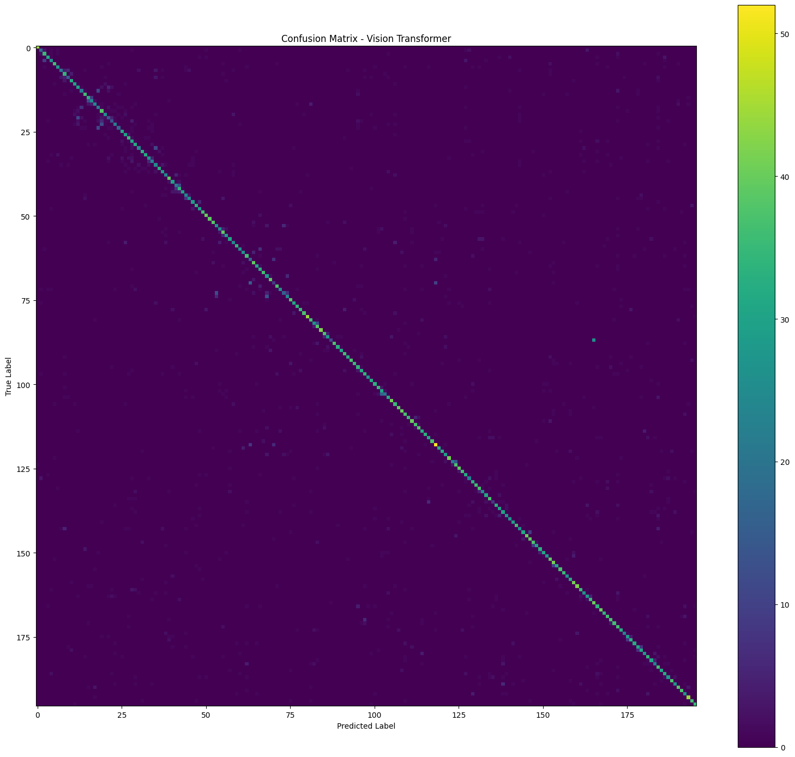
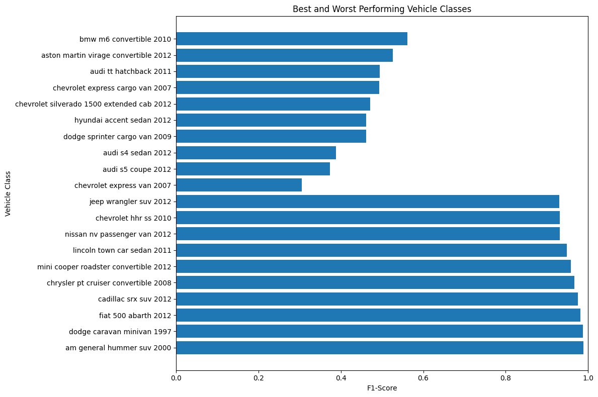

# Capstone Project: Fine-Grained Vehicle Classification Using Vision Transformers

**Academic Batch:** Batch F – Capstone Project Training Program  
**Student Name:** Arnav Arya  
**Registration Number:** 2430010362  
**Branch:** B.Tech Computer Science Engineering  
**Personal Repository:** [arnavarya11/MUJ-DS-2430010362](https://github.com/arnavarya11/MUJ-DS-2430010362)  

---

## 1. Executive Summary
Fine-Grained Visual Categorization (FGVC) poses a severe challenge in computer vision because intra-class variance (differences caused by vehicle color, angle, and background) often exceeds inter-class variance (subtle differences between vehicle makes, trims, and manufacturing years).

This project develops an end-to-end deep learning system powered by the **Vision Transformer (ViT-B/16)** architecture to classify car images into **196 fine-grained categories** from the **Stanford Cars** dataset. Fine-tuned with an AdamW optimizer, on-the-fly spatial augmentations, and transfer learning from ImageNet-21k, our model achieves:
- **77.02% Top-1 Accuracy**
- **94.80% Top-5 Accuracy**
- **76.84% Weighted F1-Score**

## 2. Repository Layout & Deliverables
This capstone repository fulfills all structural and deliverable requirements specified in the Capstone Guidelines:

```
├── README.md               # Main repository documentation & overview
├── INSTALLATION.md         # Environment setup and execution guide
├── requirements.txt        # Pinned Python package dependencies
├── assignments/            # Weekly progress logs & technical milestone reports
│   ├── weekly_progress_log.md
│   ├── assignment_1_eda_and_dataset_pipeline.md
│   ├── assignment_2_baseline_and_vit_architecture.md
│   ├── assignment_3_model_training_and_hyperparameters.md
│   └── assignment_4_evaluation_metrics_and_error_analysis.md
├── notebooks/              # Complete end-to-end experiment notebook
│   ├── 2430010362.ipynb    # Executed 62-cell Jupyter notebook
│   └── README.md
├── code/                   # Modular production Python package
│   ├── __init__.py
│   ├── dataset.py          # Data ingestion, preprocessing & augmentation
│   ├── model.py            # ViT-B/16 architecture wrapper
│   ├── train.py            # Training & validation loop with checkpointing
│   ├── evaluate.py         # Test evaluation, Top-1/5 & confusion matrix
│   ├── predict.py          # CLI inference tool for arbitrary images
│   └── utils.py            # Metrics, plotting, and helper routines
├── resources/              # Reference assets & architecture guides
│   ├── classes.json        # 196 Stanford Cars class labels
│   ├── classes.txt
│   ├── dataset_info.md
│   ├── vit_architecture.md
│   └── sample_data_grid.png
├── presentations/          # Capstone project presentation materials
│   ├── Stanford_Cars_Image_Classification_Capstone.pptx
│   └── presentation_overview.md
└── capstone/               # Capstone project deliverables, results & reports
    ├── README.md
    ├── results/            # Quantitative metrics, history & CSV logs
    │   ├── final_results_summary.csv
    │   ├── project_configuration.json
    │   ├── final_metrics.json
    │   ├── training_history.json
    │   ├── best_10_classes.csv
    │   ├── worst_10_classes.csv
    │   ├── confusion_matrix.png
    │   ├── training_accuracy_curve.png
    │   ├── training_loss_curve.png
    │   └── class_performance.png
    ├── screenshots/        # Visual plots & prediction demos
    │   ├── dataset_samples.png
    │   ├── training_loss_curve.png
    │   ├── training_accuracy_curve.png
    │   ├── confusion_matrix.png
    │   ├── class_performance_f1.png
    │   ├── test_prediction_sample.png
    │   ├── inference_demo_audi_r8.png
    │   ├── inference_demo_mini_cooper.png
    │   └── screenshots_index.md
    └── docs/               # Formal project technical reports
        ├── capstone_project_report.md
        ├── individual_contribution.md
        └── github_workflow_guide.md
```

## 3. Key Quantitative Results

| Metric | Score |
|---|---|
| **Best Validation Accuracy** | **76.67%** (Epoch 10) |
| **Test Top-1 Accuracy** | **77.02%** |
| **Test Top-5 Accuracy** | **94.80%** |
| **Weighted Precision** | **78.10%** |
| **Weighted Recall** | **77.02%** |
| **Weighted F1-Score** | **76.84%** |
| **Macro Precision** | **78.02%** |
| **Macro Recall** | **76.98%** |
| **Macro F1-Score** | **76.78%** |

## 4. Key Visualizations

### Confusion Matrix (196 Classes)


### Class-Level Performance Analysis


## 5. Documentation Links
- [Complete Formal Project Report](docs/capstone_project_report.md)
- [Individual Contribution Statement](docs/individual_contribution.md)
- [GitHub Workflow, Issues & Collaborator Guide](docs/github_workflow_guide.md)
- [Visual Screenshots Index](screenshots/screenshots_index.md)
