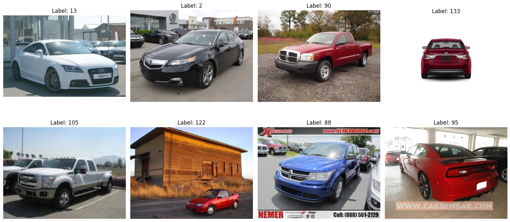
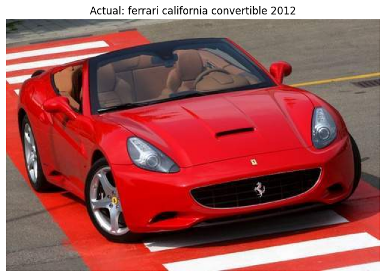

# Visual Deliverables & Screenshots Index

This directory archives all visual artifacts, training trajectory graphs, confusion matrix heatmaps, and inference demonstration screenshots generated during the project lifecycle.

---

## 1. Dataset Exploration Sample
- **Filename:** [`dataset_samples.png`](dataset_samples.png)
- **Description:** 8-sample visual grid illustrating diverse car makes, body shapes, camera poses, lighting variations, and cluttered background environments in the Stanford Cars dataset.

---

## 2. Training & Validation Loss Curve
- **Filename:** [`training_loss_curve.png`](training_loss_curve.png)
- **Description:** 10-epoch cross-entropy loss trajectory showing steady convergence from $4.9415 \rightarrow 0.3146$ (training) and $4.4773 \rightarrow 1.0938$ (validation).

---

## 3. Training & Validation Accuracy Curve
- **Filename:** [`training_accuracy_curve.png`](training_accuracy_curve.png)
- **Description:** Progression of classification accuracy over 10 epochs. Validation accuracy advances from $8.84\% \rightarrow 76.67\%$, demonstrating robust generalization.

---

## 4. Confusion Matrix Heatmap (196 Classes)
- **Filename:** [`confusion_matrix.png`](confusion_matrix.png)
- **Description:** $196 \times 196$ matrix illustrating predictions against ground truth labels over the entire 8,041-image test set. The prominent, dense diagonal confirms strong discriminative performance across the vehicle taxonomy.

---

## 5. Class-Level F1-Score Breakdown (Best 10 vs. Worst 10)
- **Filename:** [`class_performance_f1.png`](class_performance_f1.png)
- **Description:** Horizontal bar chart contrasting the 10 top-performing vehicle categories (e.g., Hummer H1, Dodge Caravan, Fiat 500 Abarth with F1 $> 0.93$) against the 10 lowest-performing categories (e.g., Chevrolet Express Van variants, Audi S4/S5 sedans).

---

## 6. Test Set Prediction Sample
- **Filename:** [`test_prediction_sample.png`](test_prediction_sample.png)
- **Description:** Qualitative evaluation on an arbitrary test image, displaying ground truth vs. model prediction and softmax confidence score.

---

## 7. Real-World Inference Demos

### Demo 1: Audi R8 Coupe 2012
- **Filename:** [`inference_demo_audi_r8.png`](inference_demo_audi_r8.png)
- **Prediction:** `Audi R8 Coupe 2012` with **69.81% confidence** (Correct Top-1).

### Demo 2: Mini Cooper Roadster Convertible 2012
- **Filename:** [`inference_demo_mini_cooper.png`](inference_demo_mini_cooper.png)
- **Prediction:** `Mini Cooper Roadster Convertible 2012` with **31.76% confidence** (Correct Top-1).

